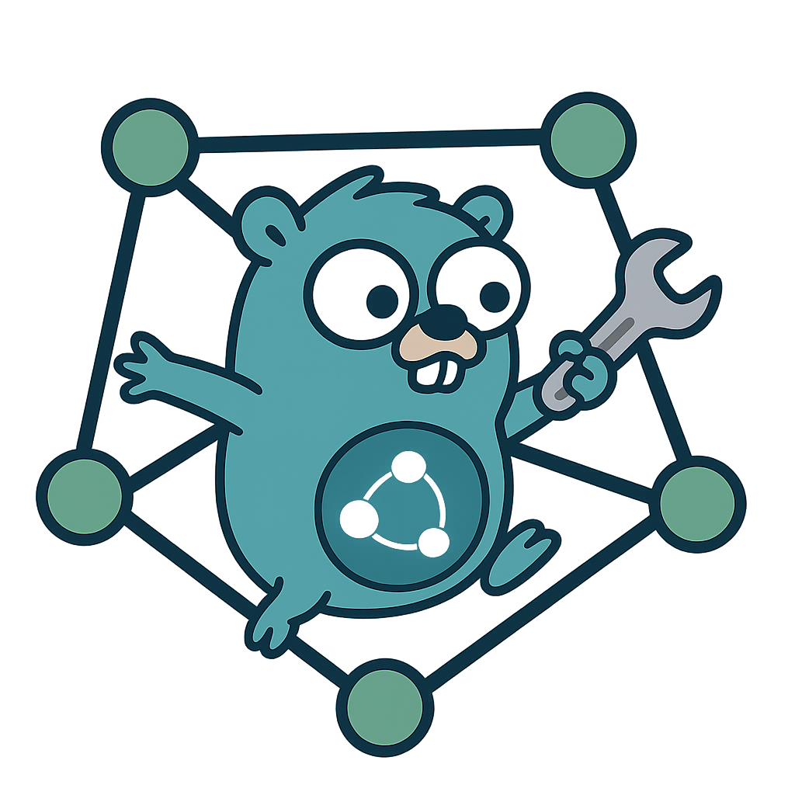

# GQLS - GQL to Neo4j Schema Converter

[](https://opensource.org/licenses/MIT)
[](https://opensource.org/licenses/apache-2-0)
[](https://github.com/marcfrederick/gqls/actions/workflows/test.yml)

<div align="center">
    
</div>

GQLS is a CLI tool that converts GQL schema definitions (ISO/IEC 39075:2024) into Neo4j-compatible Cypher statements.

## Features

- Parse GQL schema files and generate Neo4j constraints.
- Support for multiple Neo4j versions.
- Command-line interface for ease of use.

## Installation

### Prerequisites

- [Go](https://golang.org/doc/install) (>= 1.23)
- [Make](https://www.gnu.org/software/make/) (for building)
- [ANTLR4](https://www.antlr.org/download.html) (available as `antlr` in `$PATH`)

### Clone and Build

```shell
git clone https://github.com/marcfrederick/gqls.git
cd gqls
make build
```

### Generate the Parser

Before building, generate the ANTLR4 parser files:

```shell
make generate
```

This will populate the `parser/` directory with Go bindings for the GQL grammar.

## Usage

Run the `gqls` command with the required options:

```bash
./gqls --input schema.gql --neo4j-version 5.9
```

### Options

| Flag	              | Description                                                             |
|--------------------|-------------------------------------------------------------------------|
| `--input`, `-i`	   | Path to the GQL schema file. Use - or omit to read from stdin.          |
| `--neo4j-version`	 | Target Neo4j version (e.g., 5.9). Defaults to latest supported version. |

## Development

### Linting

This project uses `golangci-lint` for linting. Run the following command to check for linting issues:

```bash
make lint
```

### Testing

Run unit tests using:

```bash
make test
```

### Contributing

1. Fork the repository.
2. Create a new branch for your feature or bugfix.
3. Submit a pull request with a detailed description of your changes.

## License

This project is dual-licensed under the [MIT License](LICENSE-MIT) and the [Apache License 2.0](LICENSE-APACHE).
You can choose either license for your use.

## Acknowledgments

- [opengql/grammar](https://github.com/opengql/grammar) for the ANTLR4 translation of the GQL grammar.
